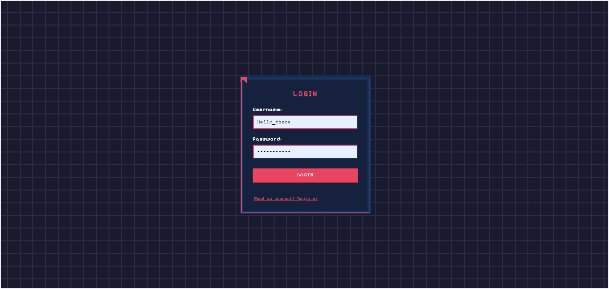
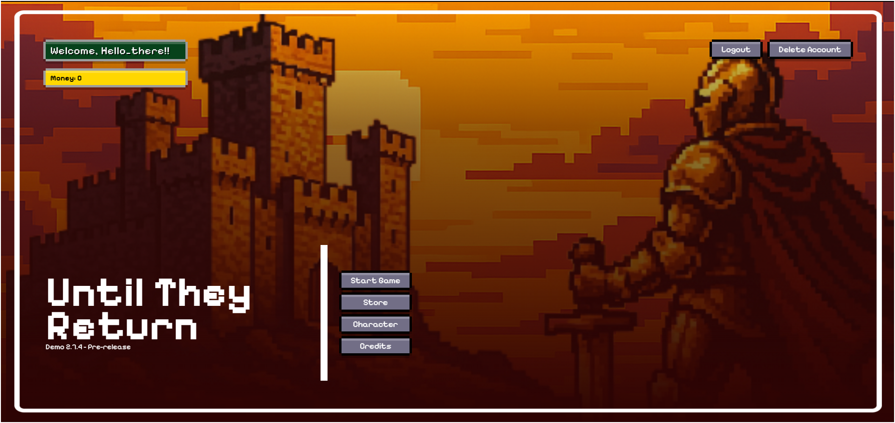
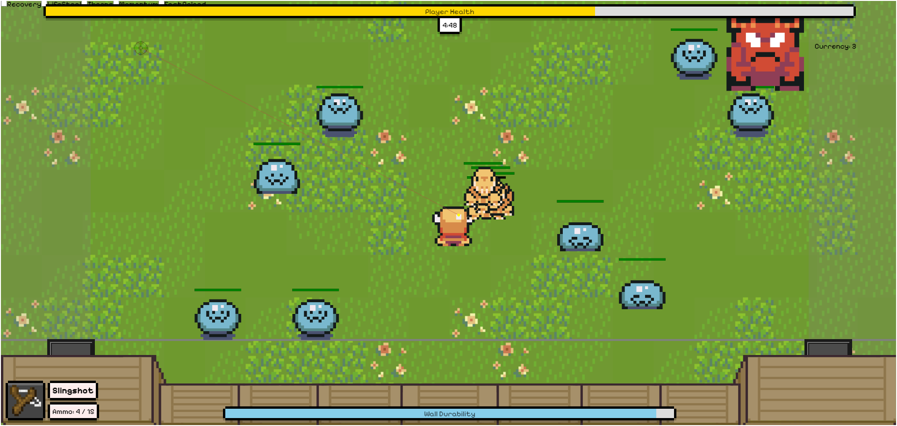
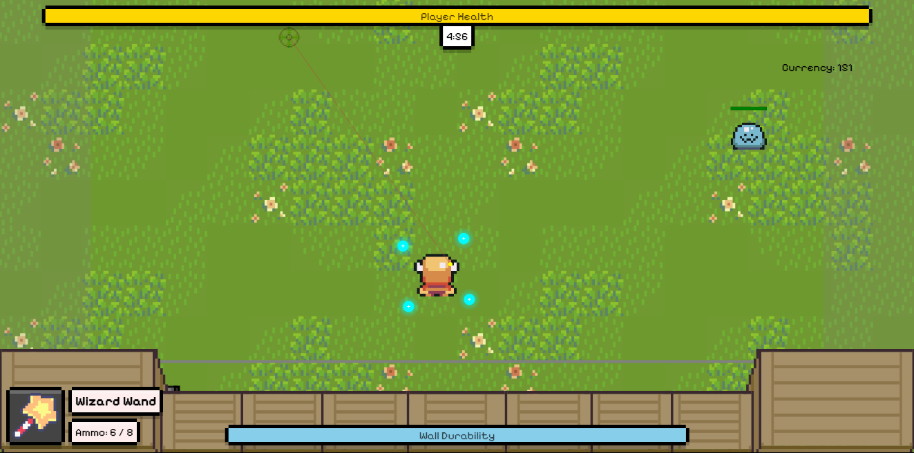
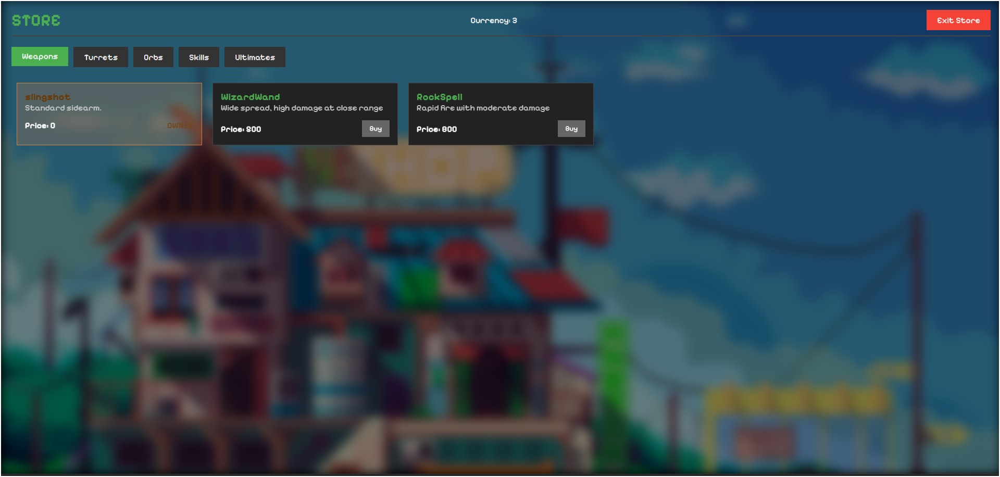
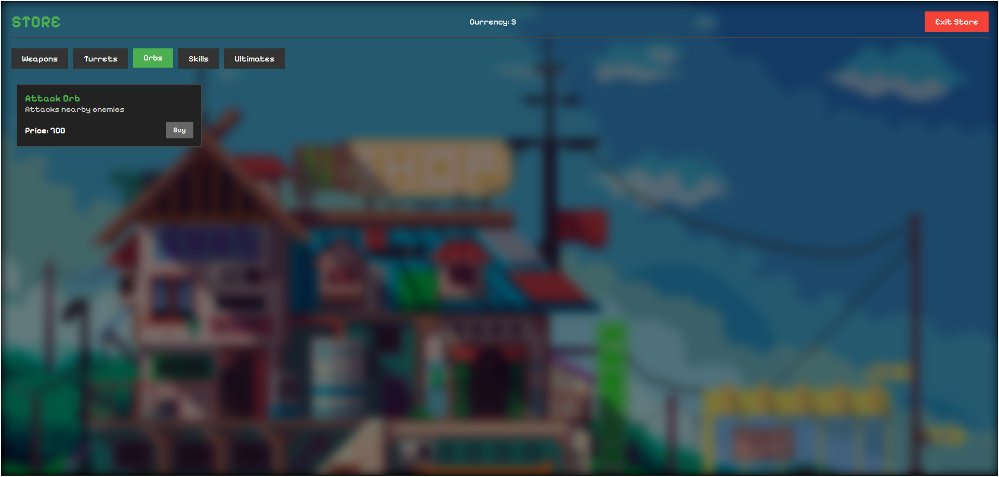
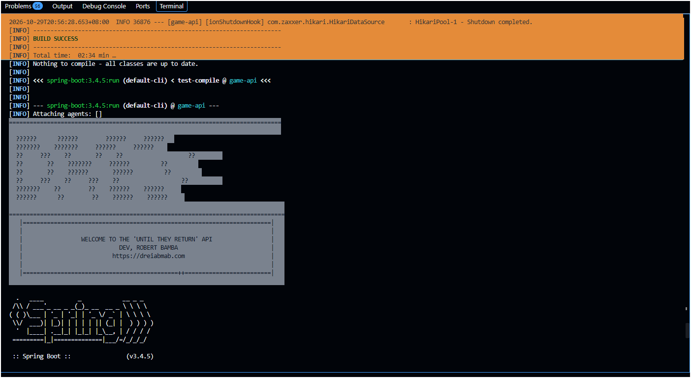
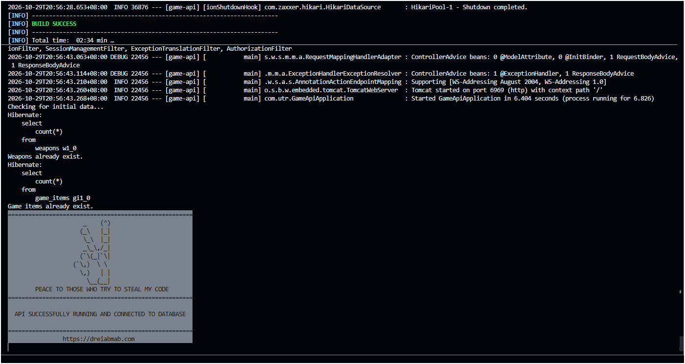

# Until They Return
#### Made By: Dreigonnadoit 
##### Previously: DreadFront

**Until They Return** is a base defense level-based survival game where players must protect their stronghold from relentless waves of the monsters summoned by one of the Demon Lords Generals. Arm yourself, fortify your defenses, and survive the dread that’s coming.

---

## 🎮 Gameplay Overview

- **Genre**: Top-down base defense, monster survival
- **Core Mechanics**:
- 
  - Defend your base from escalating monster waves
  - Upgrade weapons and skills
  - Repair and reinforce your defenses
  - Face different monster types (nomal, fast, tanky, etc.)
    - **Slime** (Normal Type): These monsters exist solely to sacrifice themselves in order to weaken or destroy obstacles in their path. The demon army deploys them to corrode and dissolve enemy walls and defenses.

    - **Lizard Men** (Tracker / Fast Type): Agile and aggressive, Lizard Men excel in high-speed combat, overwhelming enemies with sheer speed and numbers. However, their lightweight build makes them fragile and vulnerable to direct attacks.

    - **Oni** (Heavy / Tank Type): Oni are powerful brutes with devastating attacks and thick, armor-like skin that grants them strong resistance to damage. Despite their strength, their large size and slow movement make them easy targets for ranged attacks, allowing defenders a chance to eliminate them before they reach the fortress.


## **Current Passive Skills:**


| Passive Skills | Description                                                                                              |
|----------------|----------------------------------------------------------------------------------------------------------|
| Recovery       | Player gradually recovers health after a set amount of time when damage is taken.                        |
| Life Steal     | Player regains health through damaging enemies.                                                          |
| Thorns         | Apply greater damage to enemies when they bump into you.                                                 |
| Momentum       | If the player does not receive damage over a set interval, they gain an additional movement speed boost. |
| Fast Reaload   | Shorten Amount of time that is needed to reload.                                                         |

---

## **Planned Features**:
  - Weapon upgrade system
  - Power-ups
  - Player stats tracking
  - Multiplayer or co-op mode *(coming soon)*
  - More Passive Skills
  - Dragons Breath
  - Orb Types
  - Turret Types

---

## 📸 Screenshots

### Login screen



*Players sign in with a username and password. New players can register from the link below the form. Authentication is handled by the Spring Boot API using JWT.*

### Main menu



*The home screen after logging in. It shows the player's name and money, with options to start the game, visit the store, customise the character, view the credits, log out or delete the account.*

### Gameplay: defending the fortress



*Mid-wave with the starting Slingshot. Slimes and a red Oni close in on the wall while the HUD shows player health, the round timer, currency, equipped weapon with ammo, passive skills along the top, and the wall's durability at the bottom.*

### Gameplay: Wizard Wand and Attack Orbs



*A later run with the Wizard Wand equipped. Cyan Attack Orbs circle the player and hit nearby enemies automatically.*

### Store: weapons



*Currency earned in-game is spent in the store. The Weapons tab lists the free Slingshot (owned), the Wizard Wand (wide spread, high damage at close range) and the Rock Spell (rapid fire, moderate damage). Other tabs cover Turrets, Orbs, Skills and Ultimates.*

### Store: orbs



*The Orbs tab offers the Attack Orb, which attacks nearby enemies.*

### Backend: startup



*The Spring Boot API (v3.4.5) starting up from the terminal.*

### Backend: running



*The API started successfully on port 6969, connected to PostgreSQL, with the initial weapons and game items already seeded.*

---

## 🧱 Built With

- **Frontend:** Vite + React 19, React Router, Framer Motion, Axios
- **Backend:** Spring Boot 3.4 (Java 17), Spring Data JPA, JWT authentication
- **Database:** PostgreSQL

---

## 🚀 Getting Started

The project has two parts: `frontend/` (the game) and `backend/` (the API for accounts and player data).

### Prerequisites

- [Node.js](https://nodejs.org/) 18+
- [Java JDK](https://adoptium.net/) 17+
- [PostgreSQL](https://www.postgresql.org/download/) (default port `5432`)

### 1. Clone the repository

```bash
git clone https://github.com/Dreigannadoit/the_fortress_frontend.git
cd the_fortress_frontend
```

### 2. Create the database

Create an empty PostgreSQL database named `utr`. Tables are created automatically on first run.

```bash
psql -U postgres -c "CREATE DATABASE utr;"
```

> **Windows:** if `psql` isn't recognized, use the full path (e.g. `"C:\Program Files\PostgreSQL\17\bin\psql.exe"`) or create the database from **pgAdmin** (right-click *Databases* → *Create* → *Database*).

### 3. Configure the backend

Edit `backend/.env` to match your setup:

```env
DATASOURCE_URL=jdbc:postgresql://localhost:5432/utr
DATASOURCE_USER=postgres
DATASOURCE_PASSWORD=your_postgres_password
SERVER_PORT=6969

FRONTEND_URL_ONE=http://localhost:5173
FRONTEND_URL_TWO=http://127.0.0.1:5173
# ...additional allowed frontend origins (CORS)
```

> If your PostgreSQL runs on a different port (e.g. `5433` when multiple versions are installed), change it in `DATASOURCE_URL`.

### 4. Run the backend

Spring Boot does **not** read `.env` files on its own, so load the variables into your terminal first. The API runs at `http://localhost:6969`.

**Git Bash / macOS / Linux**

```bash
cd backend
set -a; source .env; set +a
./mvnw spring-boot:run
```

**PowerShell**

```powershell
cd backend
Get-Content .env | ForEach-Object {
  if ($_ -match '^\s*([^#=]+)=(.*)$') { [Environment]::SetEnvironmentVariable($matches[1].Trim(), $matches[2].Trim(), 'Process') }
}
.\mvnw.cmd spring-boot:run
```

The backend is ready when you see `Started GameApiApplication`.

### 5. Run the frontend

In a second terminal:

```bash
cd frontend
npm install
npm run dev
```

Open **http://localhost:5173**. The frontend reads the API address from `frontend/.env`:

```env
VITE_API_BASE_URL=http://localhost:6969/api
```

### Troubleshooting

| Problem | Fix |
|---------|-----|
| `Failed to bind properties under 'server.port'` / `${SERVER_PORT}` | The `.env` variables weren't loaded. Run the commands in step 4 in the **same terminal** as `mvnw`. |
| `password authentication failed` | `DATASOURCE_PASSWORD` doesn't match your PostgreSQL password. |
| `database "utr" does not exist` | Create the database (step 2). |
| CORS errors in the browser | Run the frontend on port `5173`, `42069`, or `3000`, or add your origin to `backend/.env`. |
| `psql` not recognized (Windows) | Use the full path to `psql.exe` or pgAdmin (see step 2). |
| Port already in use | Change `SERVER_PORT` in `backend/.env` and update `VITE_API_BASE_URL` in `frontend/.env` to match. |

> Only want to look at the UI? `npm run dev` in `frontend/` works on its own, but anything needing the API (such as login) won't work without the backend.

---

## Credits

Music

DJARTMUSIC - The Return Of The 8-bit Era- https://pixabay.com/music/search/genre/video%20games/
DJARTMUSIC - Best Game Console - https://pixabay.com/music/search/genre/video%20games/
Grand_Project - Breath of Life_10 minutes - https://pixabay.com/music/meditationspiritual-breath-of-life-10-minutes-320859/


SFX - https://pixabay.com


Graphics

pixel-boy - Ninja Adventure - Asset Pack - https://pixel-boy.itch.io/ninja-adventure-asset-pack

Sideshop - faxdoc - https://www.deviantart.com/faxdoc/art/Sideshop-566561669